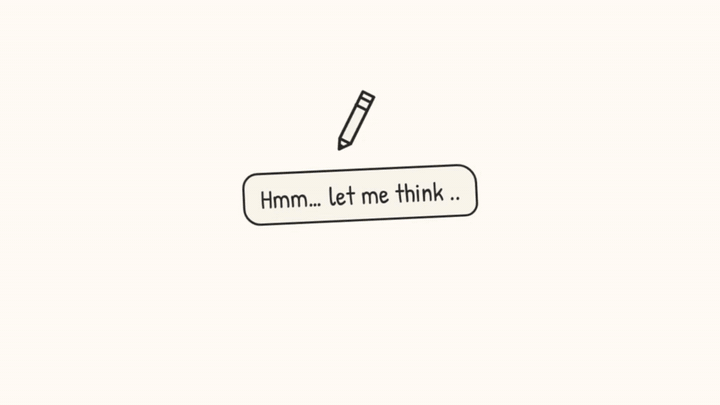

# Draw It If You Can

[](https://github.com/sowebdev/symfony-ai-hackathon-2026-draw-it-if-you-can/actions/workflows/ci.yml)

AI doesn't always have to be about productivity. It can also be fun.

Draw It If You Can is a drawing and guessing game you play with an AI, taking turns. When you draw, the AI watches your sketch grow and shouts out one word at a time, like a friend around the table. When the AI draws, you guess: it picks up the pencil and draws live, stroke by stroke, with the wobble of a human hand. The AI is Olaf, a penguin, and a walrus with a whistle referees everyone: « ça chauffe » when an answer is close, « c'est juste » when it is the word, more forgiving in the easy mode.

Bring your own agent along over MCP: Claude Code, Mistral Vibe or any client whose model sees images joins from the lobby, picks itself a funny nickname, and plays as your copilot or races you to the answer in a duel.

Plug in the model you like, from a cloud API or on your own machine: this may be the first time you want a decent graphics card for something other than 3D games.

Built with Symfony AI for the Symfony AI hackathon (November 2026). The game speaks English, French, German, Spanish and Italian.

**Tested on real kids, my own :)**

[](https://youtu.be/oz9XYaZwmiU)

Click the animation to watch the 90-second video on YouTube.

## Play in three steps

You need Docker, make, and a model: a cloud API key, or a model server of your own.

1. `make install`: it builds the image, installs the dependencies and the database, and asks nothing. The game runs in Symfony's production environment. After an update of the game (`git pull`), run it again.
2. Open the address it ends with, http://127.0.0.1:8040 unless that port is taken (`make start` gives it again), and **choose your models** on the page, one question at a time: which AI draws (Anthropic, OpenAI, Mistral, or your own server or another OpenAI-compatible service such as Ollama, LM Studio or OpenRouter), your API key, its model (the middle of the provider's range is preselected, from [models.dev](https://models.dev)); the guesser and the judge use the same AI unless you give each another one, at any provider. "Check and play" tries them and saves them when they pass. Your keys are kept encrypted in the game's database.
3. Draw, guess, laugh.

"Configure the model" at the bottom of the home page opens the same screen later, and `make check` tells you in a terminal whether the model can play.

**The game listens on 127.0.0.1 only, and the model screen has no login: do not expose it to a network.** Whoever reaches it can change the model and make the game call any address.

## Which model for the most fun?

A poor drawer makes you laugh, a good one makes you play.

- **Claude Haiku 5.5** is plenty, for drawing as for guessing.
- **OpenAI** draws well too: GPT-6 Luna for almost nothing, GPT-6.2 Astra the cleanest drawings I got, but slowly.
- **Qwen 3.8 27B on your own machine** is the sweet spot for fun: it draws a cat with whiskers or a snail with its shell, for free, if you have a GPU with 16 GB or a Mac with enough memory.
- **Mistral** has its place in the game, as a provider of its own and with Mistral Vibe as an agent, but I cannot recommend it for now. In my tries, Mistral Small 4 answered in half a second yet missed a clear swan, and Mistral Medium 3.5 drew a kangaroo in 47 strokes that nobody could guess. Mistral Large 4 always reasons: it often spends its answer thinking and fails the model check, and once past it, it plays badly. Its reasoning could surely be tuned, but I chose not to tune the game for one model (sorry, Mistral).

The same cat, windmill and train drawn by eleven models, from Anthropic, OpenAI, Mistral and on my own machine: [docs/bench](docs/bench/README.md).

The model must see images and call tools. Details, the models I tried, reasoning, and what to do when it does not play: [docs/models.md](docs/models.md).

## Play with your agent

The game is an MCP server. With Claude Code, while the game runs:

```bash
claude mcp add --scope user --transport http draw-it http://127.0.0.1:8040/mcp
```

Allow its tools when you open your agent, `claude --allowedTools mcp__draw-it` with Claude Code, or it asks you at every move. Then pick "With a copilot" or "Duel" on the home page: the lobby tells you what to do next, and when your agent is in. Mistral Vibe, the tools and the rules: [docs/mcp.md](docs/mcp.md).

## How it works

One Symfony application, SQLite, server-sent events, and Symfony AI between the game and the models: the model plays, the code judges. Diagrams and principles: [docs/architecture.md](docs/architecture.md).

What changed in each version: [CHANGELOG.md](CHANGELOG.md).

## Contributions to Symfony AI

Building the game on the beta of Symfony AI turned up a bug: the Generic bridge dropped the arguments carried by the chunk that starts a streamed tool call. The fix, [symfony/ai#2940](https://github.com/symfony/ai/pull/2940), is merged; until it is released, the game assembles streamed tool calls itself.

## Licence and credits

The code of the game is under the [MIT license](LICENSE).

- **Patrick Hand**, the handwriting font, by Patrick Wagesreiter, under the [SIL Open Font License 1.1](assets/fonts/OFL.txt). It is served by the game, without any outside call, and is not covered by the MIT license.
- **SketchAgent** (CVPR 2025, [arXiv:2411.17673](https://arxiv.org/abs/2411.17673)) gave the method the AI draws with: a 50 x 50 grid of named cells, a stroke as the cells the pen goes through. The prompts, the tool and the hand-drawn rendering are the game's own; nothing is copied from the paper, which is under CC BY-NC-SA 4.0.
- Built with [Symfony](https://symfony.com), [Symfony AI](https://github.com/symfony/ai) and its MCP bundle, on the [MCP PHP SDK](https://github.com/modelcontextprotocol/php-sdk), and [Stimulus](https://stimulus.hotwired.dev).
- The dependencies are installed by Composer and the importmap, not shipped in this repository; each keeps its own license (MIT, BSD-3-Clause for Twig, Apache-2.0 for the MCP SDK and the opis libraries). `docker compose exec php composer licenses` lists them.

## Develop

A developer works in the development environment, with the profiler and its AI panel: write `APP_ENV=dev` in `.env.local` before `make install` (or add it and run `make install` again). Commands run in the container: `docker compose exec php bin/console …`. In development the profiler keeps the headers of the requests to the models, your API key included, in `var/cache/dev/profiler`: keep that environment on your own machine.

## Tests

```bash
make test-unit        # also run by the pre-commit hook (pre-commit install)
make test-functional  # against a fresh SQLite test database
make smoke            # a solo game and a duel in a real browser, at two widths (Playwright, a scripted model)
```

`make ci` runs the first two with the linters and the static analysis. `make smoke` covers what they cannot see, the screen that moves: the game runs in its `smoke` environment, where a script replaces the models (`tests/Smoke`), and Playwright plays it in a second container, then checks the verdicts, where the walrus stands and that nothing overflows a tablet held upright. It takes a minute and downloads the Playwright image the first time, so it stays out of the pre-commit hook; the CI runs it.
