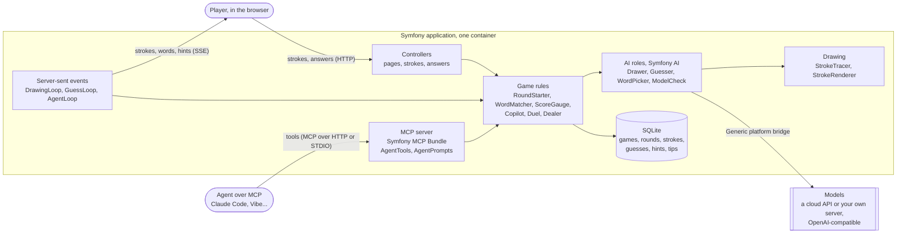
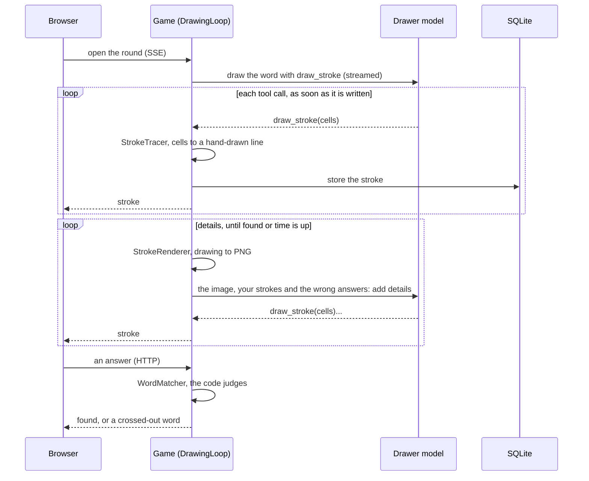
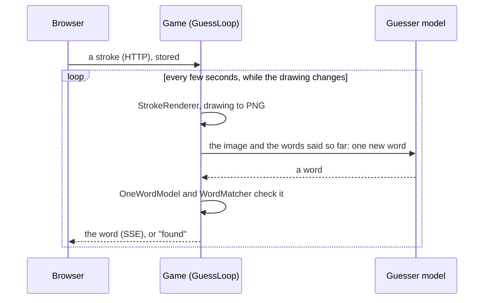

# Architecture

One Symfony application in one container, a SQLite file, and models reached over the API of OpenAI. No queue, no Mercure, no JavaScript framework: the browser gets server-sent events and a few Stimulus controllers.

## The principles

- **The model plays, the code judges.** A model never decides what counts. `WordMatcher` tells whether an answer is the word, `OneWordModel` checks that a model said one word, `ModelCheck` tries each model on a task whose answer is known. Points, time and the end of a round are the game's.
- **Two roles, any model.** The drawer and the guesser each have an endpoint, a model and a key (`Models`), on the Generic platform bridge of Symfony AI, which speaks the API of OpenAI. Both must see images; the drawer must call tools.
- **The model draws with a tool.** `Pen` is a Symfony AI tool (`#[AsTool]`), `draw_stroke`, on the 50 x 50 grid of SketchAgent. The answer is streamed, and each stroke goes to the browser as soon as its call is written, without waiting for the end of the answer (`ToolCallAssembler`, see [Contributions to Symfony AI](../README.md#contributions-to-symfony-ai)).
- **The hand is code.** The model writes grid cells; `StrokeTracer` turns them into a line that wobbles, overshoots and speeds up like a pen, deterministically. `StrokeRenderer` draws strokes into a PNG with GD, which is what the guesser, and the drawer adding details, look at.
- **The server sets the rhythm.** A round is one server-sent events response: the AI calls out a word every few seconds (`GuessLoop`), or draws until the word is found or the time is up (`DrawingLoop`). A reload replays what is stored, then follows.
- **An agent is a player, not a part of the game.** The MCP server only exposes the state of the round and what the agent may do. What it does is written to the database by the MCP request, and `AgentLoop` streams it to the browser. An agent cannot wait between two calls, so the game waits for it ([ADR 0002](adr/0002-agents-wait-on-the-server.md)).

## The AI draws, you guess

## You draw, the AI guesses

## Where things are

| Folder | What it holds |
|---|---|
| `src/Ai` | The AI roles on Symfony AI, the model check, the tool the model draws with |
| `src/Game` | The rules: rounds, time, score, themes, words, the copilot and the duel, the SSE loops |
| `src/Drawing` | Strokes: the grid, the hand-drawn line, the PNG |
| `src/Mcp` | The tools and prompts an agent sees |
| `src/Controller` | Pages and HTTP endpoints, thin |
| `src/Command` | `app:setup`, `app:ai:check`, and `app:draw`, which makes a model draw words pass after pass and writes a page to `var/bench` |
| `assets/controllers` | Stimulus: the canvas, the drawing of the AI, the timer, the agent, the lobby |
| `docs/adr` | The decisions and why |
