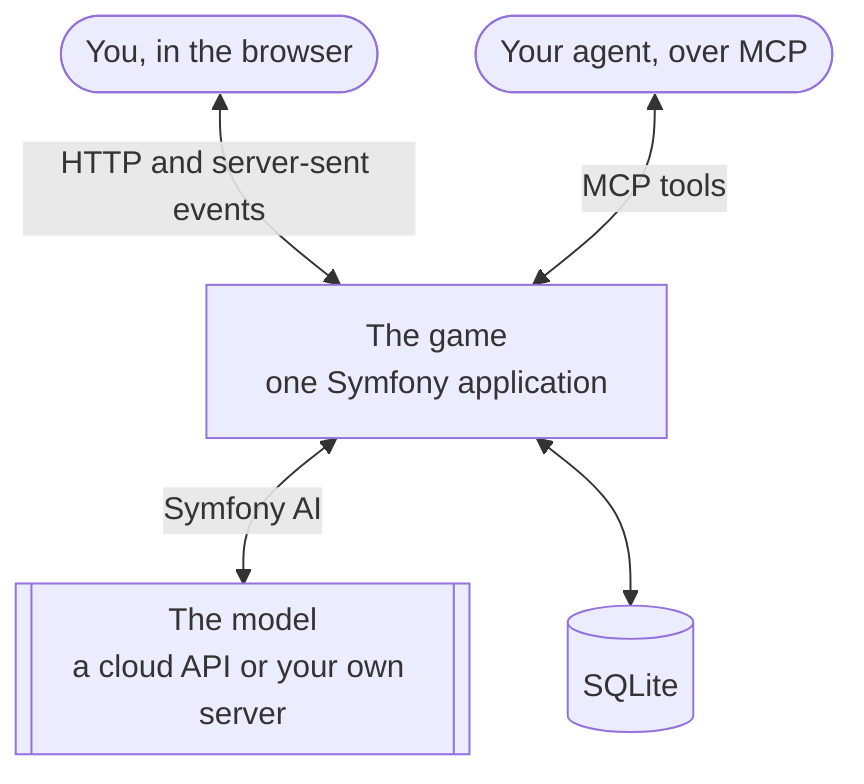
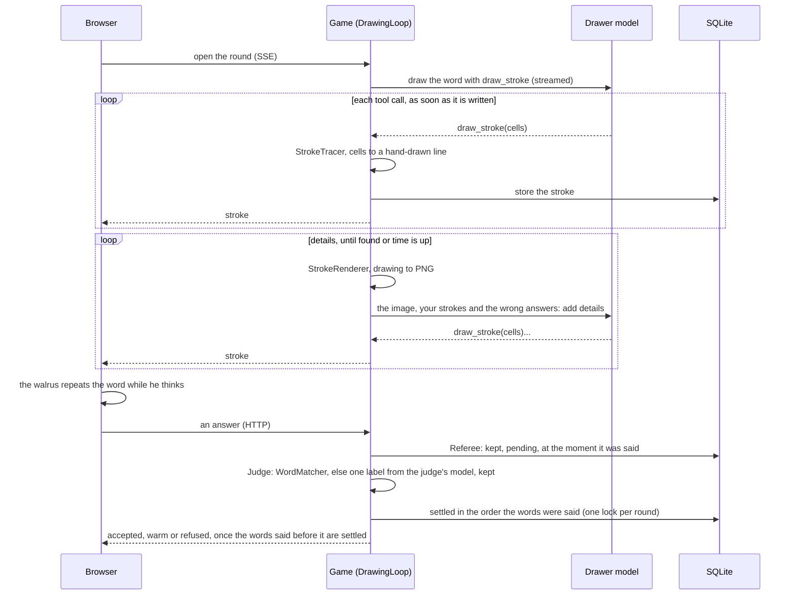
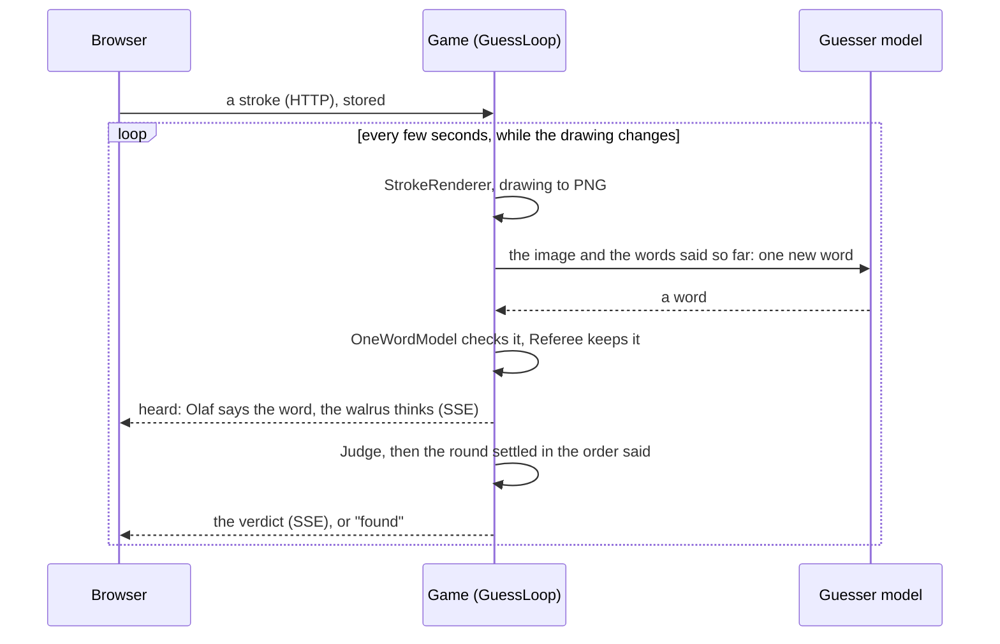
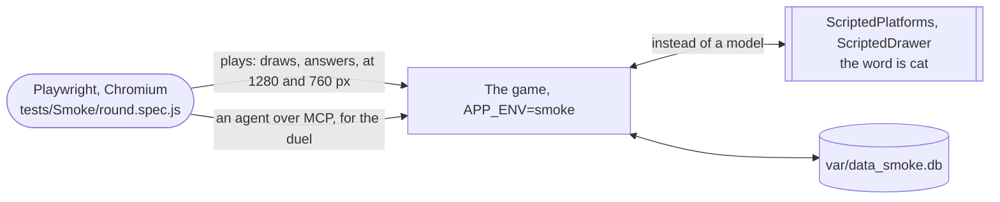

# Architecture

One Symfony application in one container, a SQLite file, and models reached through an OpenAI-compatible API, the format most providers and local servers speak. No queue, no Mercure, no JavaScript framework: the browser gets server-sent events and a few Stimulus controllers.

Inside the game, the controllers stay thin; the rules (`src/Game`) decide, the AI roles (`src/Ai`) ask the models, the drawing code (`src/Drawing`) traces and renders the strokes, and the MCP server (`src/Mcp`) lets an agent in.

## The principles

- **The model plays, the code judges.** A model never decides what counts. `WordMatcher` accepts the word or one typo; otherwise `Judge` asks the guessing model for one label and `Verdict` decides. Every answer, whoever gives it, goes through `Referee`: kept at once, pending, then judged, and the round is settled in the order the words were said, so a slow verdict never loses to a word said after it ([ADR 0006](adr/0006-the-judge-a-strict-label-a-cache-and-the-order-of-the-words.md)). `OneWordModel` checks that a model said one word, `ModelCheck` tries each model on a known task. Points, time and the end of a round are the game's.
- **Three roles, any model.** The drawer, the guesser and the judge each have a provider, a model and a key (`Models`, from the accounts and role models stored by the models screen; a guesser without a model of its own uses the drawer's, a judge the guesser's, so one model plays them all by default), on the platform bridge of that provider in Symfony AI, or on the Generic one for any OpenAI-compatible endpoint: Ollama, LM Studio, llama.cpp or OpenRouter. The drawer and the guesser must see images, the drawer must call tools; the judge only answers with a label.
- **The model draws with a tool.** `Pen` is a Symfony AI tool (`#[AsTool]`), `draw_stroke`, on the 50 x 50 grid of SketchAgent. The answer is streamed, and each stroke goes to the browser as soon as its call is written, without waiting for the end of the answer (`ToolCallAssembler`, see [Contributions to Symfony AI](../README.md#contributions-to-symfony-ai)).
- **The hand is code.** The model writes grid cells; `StrokeTracer` turns them into a line that wobbles, overshoots and speeds up like a pen, deterministically. `StrokeRenderer` draws strokes into a PNG with GD, which is what the guesser, and the drawer adding details, look at.
- **The server sets the rhythm.** A round is one server-sent events response: the AI calls out a word every few seconds (`GuessLoop`), or draws until the word is found or the time is up (`DrawingLoop`). A reload replays what is stored, then follows.
- **An agent is a player, not a part of the game.** The MCP server only exposes the state of the round and what the agent may do. What it does is written to the database by the MCP request, and `AgentLoop` streams it to the browser. An agent cannot wait between two calls, so the game waits for it ([ADR 0002](adr/0002-agents-wait-on-the-server.md)).

## The AI draws, you guess

## You draw, the AI guesses

## The smoke test

`make ci` tests the PHP; `make smoke` tests what moves on screen. Two containers of their own, started only by it (the `smoke` profile of `compose.yaml`): the game in its `smoke` environment, where a script replaces the models and the dealer always deals the same themes, and Playwright beside it, on the same network, so that the game is on 127.0.0.1 like for an agent.

## Where things are

| Folder | What it holds |
|---|---|
| `src/Ai` | The AI roles on Symfony AI, the model check, the tool the model draws with |
| `src/Game` | The rules: rounds, time, score, themes, words, the copilot and the duel, the SSE loops |
| `src/Drawing` | Strokes: the grid, the hand-drawn line, the PNG |
| `src/Mcp` | The tools and prompts an agent sees |
| `src/Controller` | Pages and HTTP endpoints, thin |
| `src/Command` | `app:ai:check`, and `app:draw`, which makes a model draw words pass after pass and writes a page to `var/bench` |
| `assets/controllers` | Stimulus: the canvas, the drawing of the AI, the timer, the agent, the lobby, the referee |
| `assets/styles` | One stylesheet per screen, after the base and the characters |
| `tests/Smoke` | The smoke test: the scripted model of the `smoke` environment, and Playwright playing in a browser (`make smoke`) |
| `docs/adr` | The decisions and why |
