# The drawing bench

Each model draws the same words, one sketch each, as the AI draws at the start of a round, with nobody guessing. One try per model and word: an idea of what to expect, not a measure. The cost is that of the tokens, at the prices of [models.dev](https://models.dev); a model on your own machine costs nothing.

Written by `bin/console app:bench` from [bench.json](bench.json) and [results.json](results.json): it draws only what is missing (`--again` to draw again, `--only=haiku` for one model), then writes this page without calling any model.

| Model | cat | windmill | train |
|---|---|---|---|
| **Claude Haiku 5.5** `claude-haiku-5-5` | 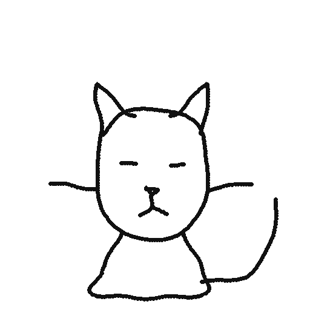 12 strokes, 7.7 s, $0.001 | 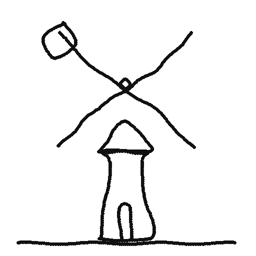 8 strokes, 8.1 s, $0.001 | 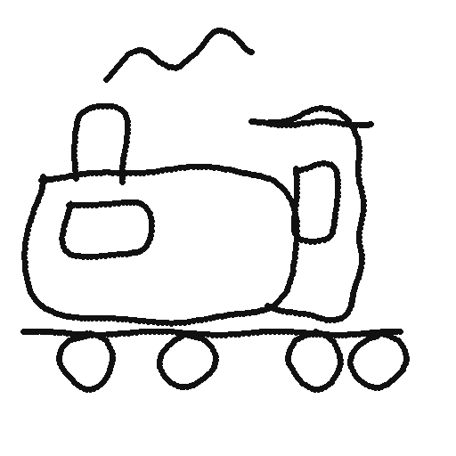 12 strokes, 8.3 s, $0.001 |
| **Claude Sonnet 5.5** `claude-sonnet-5-5` | 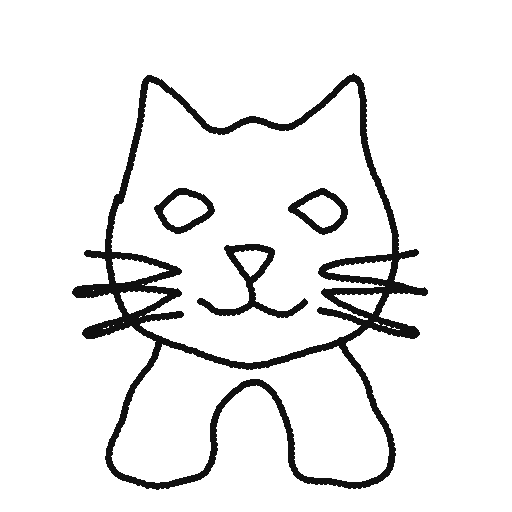 9 strokes, 6.8 s, $0.015 | 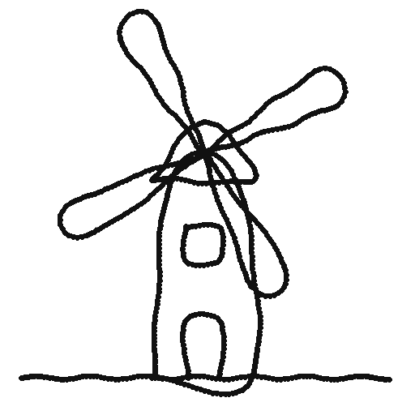 9 strokes, 11.1 s, $0.012 | 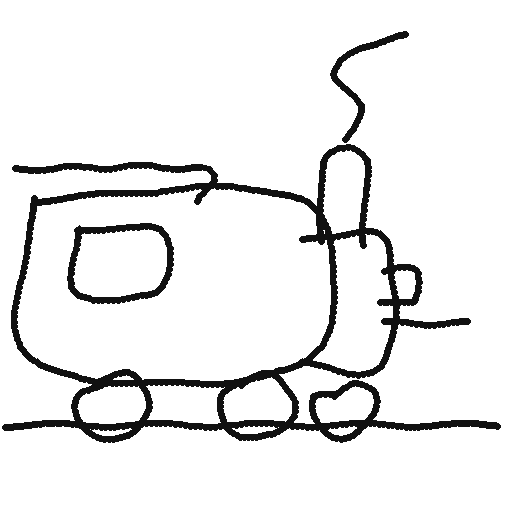 12 strokes, 18.3 s, $0.016 |
| **Claude Opus 5.5** `claude-opus-5-5` | 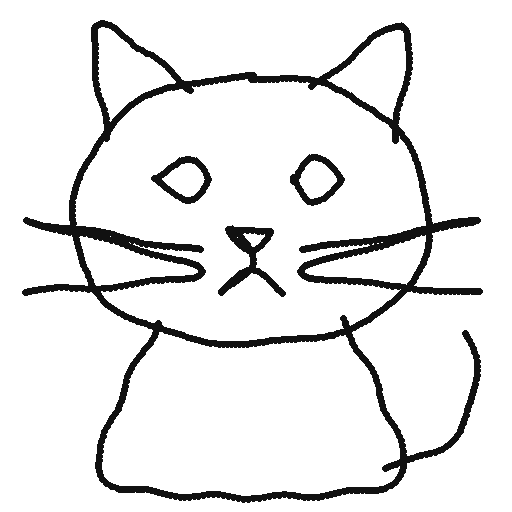 10 strokes, 8.7 s, $0.033 | 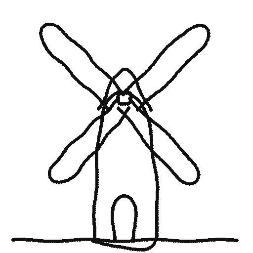 9 strokes, 7.8 s, $0.025 | 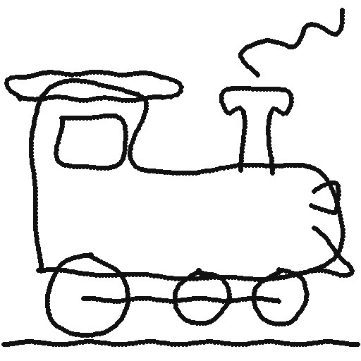 12 strokes, 15.7 s, $0.035 |
| **GPT-6 Luna** `gpt-6-luna` | 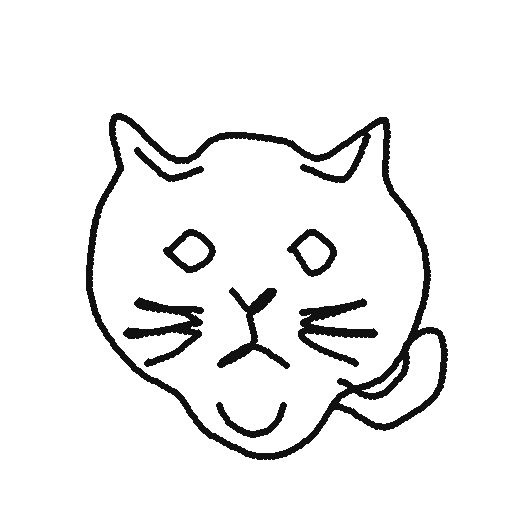 10 strokes, 11.4 s, < $0.001 | 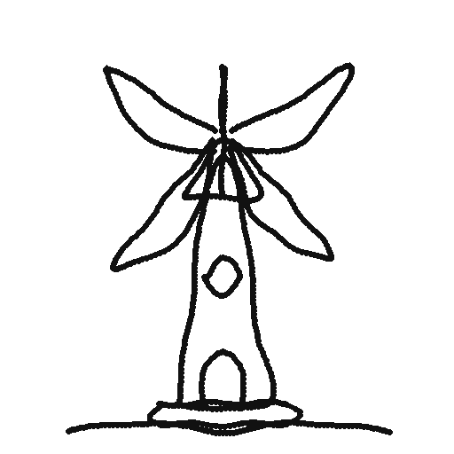 12 strokes, 7.3 s, < $0.001 | 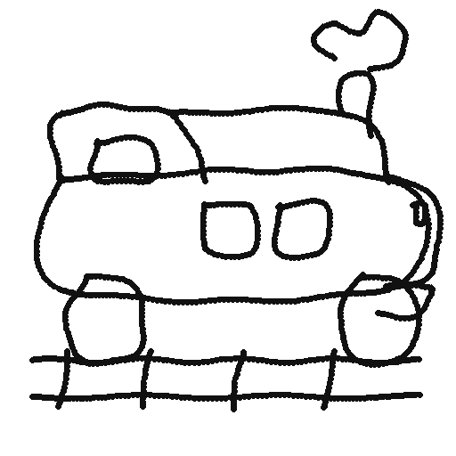 19 strokes, 14.1 s, $0.001 |
| **GPT-6.2 Sol** `gpt-6.2-sol` | 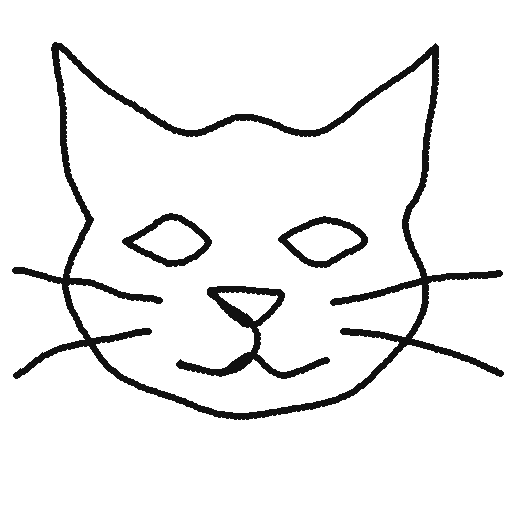 8 strokes, 15.7 s, $0.016 | 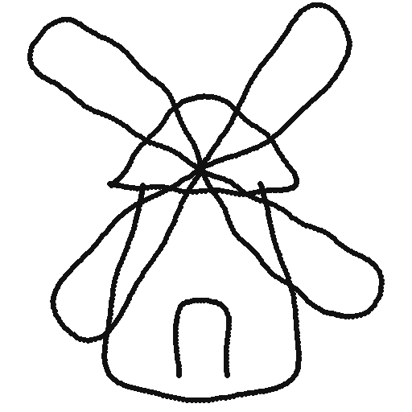 7 strokes, 13.5 s, $0.012 | 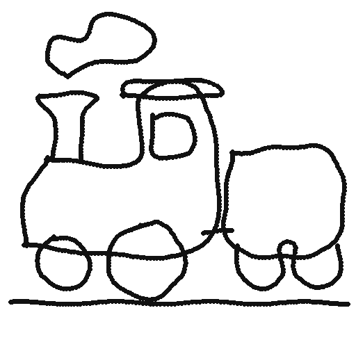 11 strokes, 22.0 s, $0.023 |
| **GPT-6.2 Astra** `gpt-6.2-astra` | 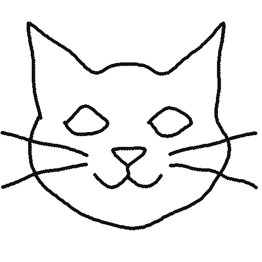 9 strokes, 24.4 s, $0.074 | 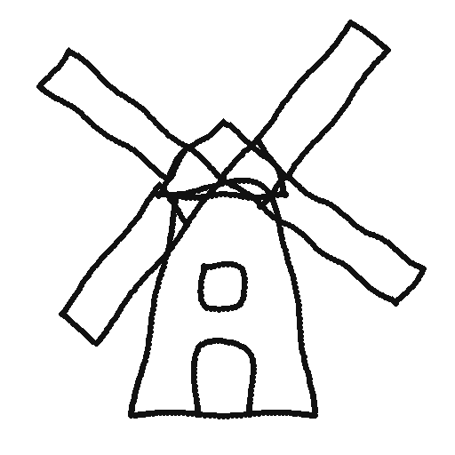 8 strokes, 22.4 s, $0.064 | 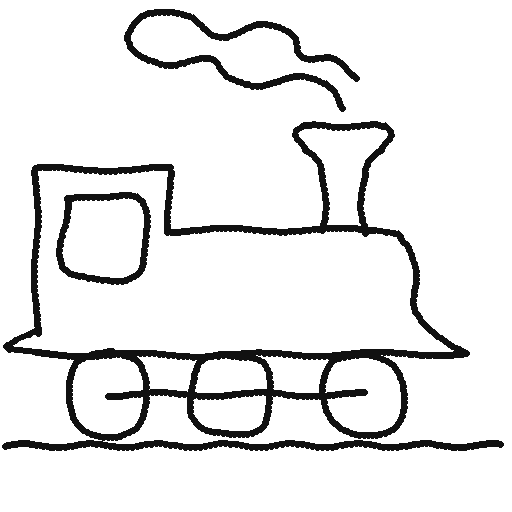 9 strokes, 35.4 s, $0.078 |
| **Mistral Small 4** `mistral-small-2603` | 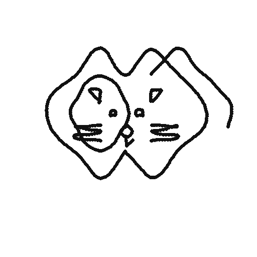 11 strokes, 3.2 s, < $0.001 | 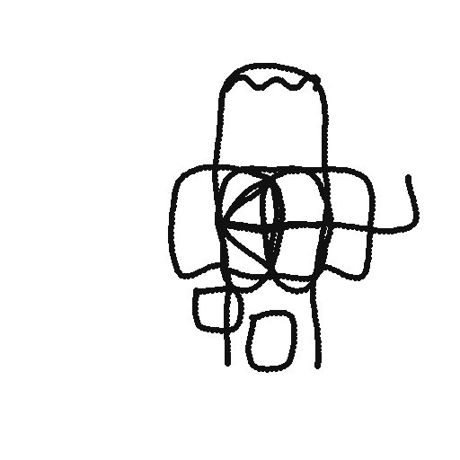 8 strokes, 3.0 s, < $0.001 | 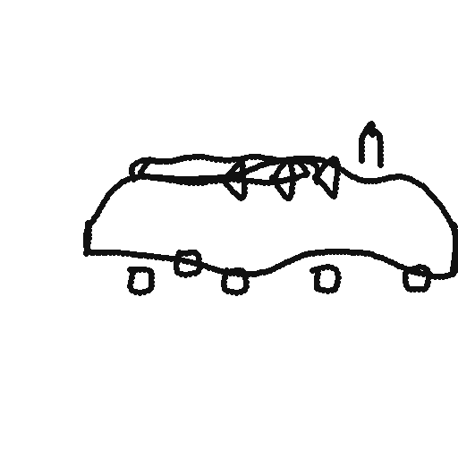 15 strokes, 4.2 s, < $0.001 |
| **Mistral Medium 3.5** `mistral-medium-2604` | 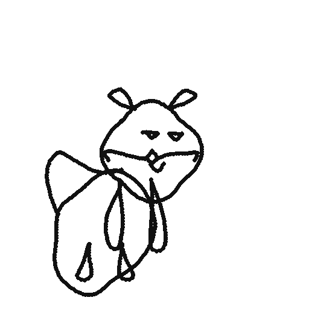 15 strokes, 4.0 s, $0.008 | 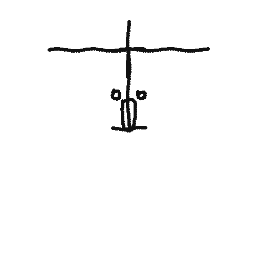 10 strokes, 2.0 s, $0.004 | 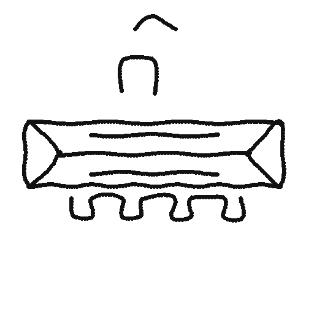 10 strokes, 3.1 s, $0.005 |
| **Mistral Large 4** `mistral-large-4` | failed: no stroke | failed: no stroke | 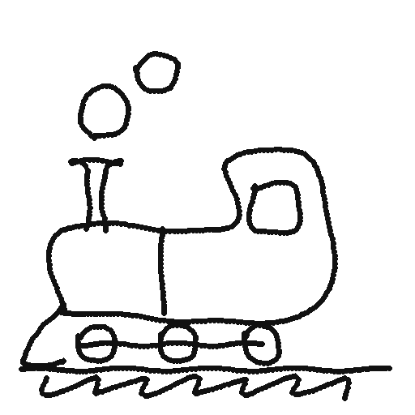 13 strokes, 58.0 s, $0.020 |
| **Qwen 3.8 27B, local** `qwen3.8-27b-vision` | 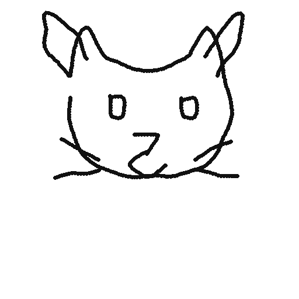 11 strokes, 33.2 s | 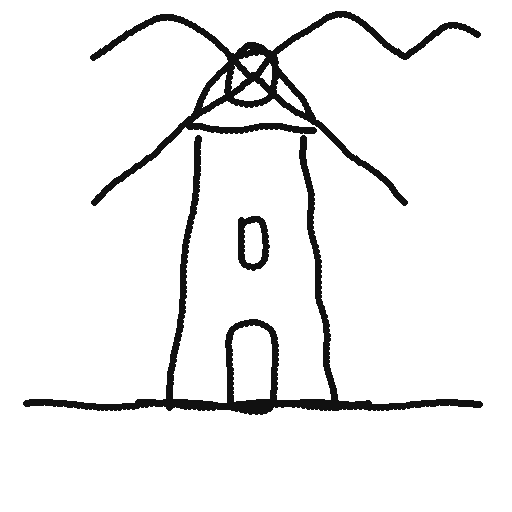 15 strokes, 34.9 s | 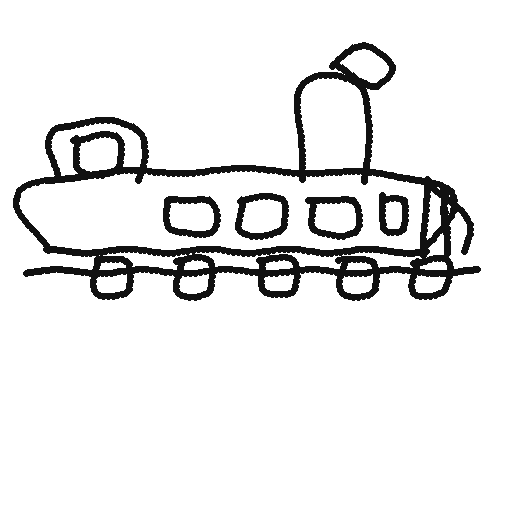 20 strokes, 50.0 s |
| **Gemma 4 12B, local** `gemma4` | 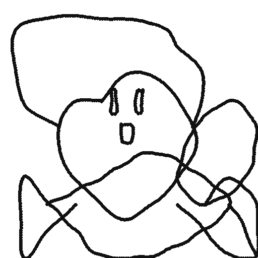 10 strokes, 5.5 s | 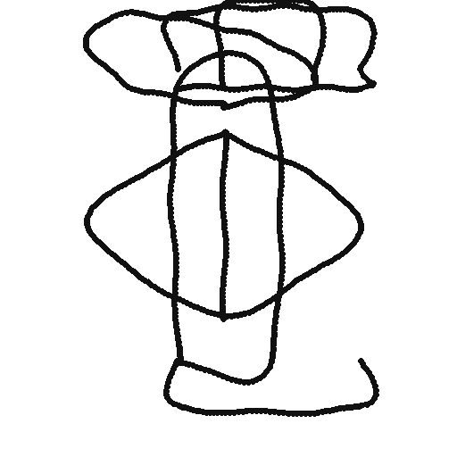 7 strokes, 4.4 s | 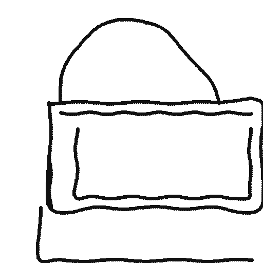 6 strokes, 6.3 s |

Drawn on 2026-11-21.
